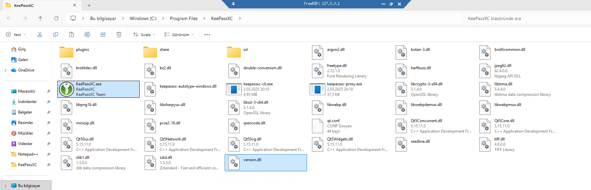
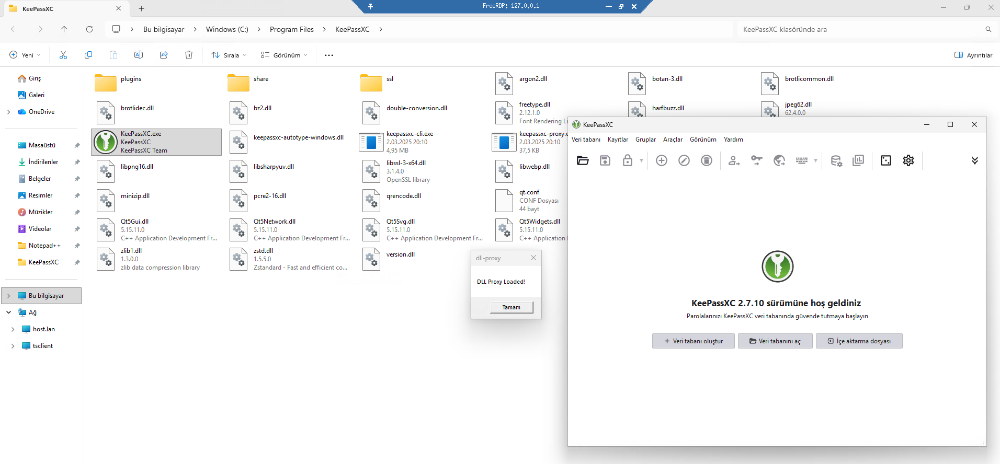

<div align="center">
  
</div>

<div align="center">
  
</div>

## It's This Simple

**You don't need to know anything complex to get started.** Just edit this one function in `main.cpp`:

```cpp
// Payload function - your custom code goes here
DWORD WINAPI Payload(LPVOID lpParam) {
    MessageBoxA(NULL, "DLL Proxy Loaded!", "dll-proxy", MB_OK);
    return 0;
}
```

That's it! Build, drop the DLL next to your target application, and your code runs instantly.

## Forwarding Methods

This project supports two export forwarding architectures:

### Linker Forwarding (default)

Uses PE-level export forwarding to `\\.\GLOBALROOT\SystemRoot\System32\<dll>.<Func>` - the Windows loader resolves these at load time, no runtime code needed.

- **MSVC**: `#pragma comment(linker, "/EXPORT:...")` directives
- **MinGW-w64**: the same forwarders through a generated `.def` file passed to GNU ld

```cpp
#pragma comment(linker, "/EXPORT:FuncName=\\\\.\\GLOBALROOT\\SystemRoot\\System32\\original.dll.FuncName,@1")
```

### Runtime Forwarding

Uses `LoadLibrary` + `GetProcAddress` to manually resolve the original DLL at startup, with x64 jump thunks providing the actual exported functions (MASM for MSVC builds, naked GNU stubs for MinGW-w64 builds).

```
┌─────────────┐      ┌──────────────────┐      ┌─────────────────┐
│  App.exe    │────▶│  proxy winmm.dll │────▶│ System winmm.dll│
│             │      │                  │      │  (System32)     │
│ calls       │      │ 1. LoadLibraryA  │      │                 │
│ timeGetTime │      │ 2. GetProcAddress│      │ Real functions  │
│             │      │ 3. ASM JMP thunk │      │                 │
└─────────────┘      └──────────────────┘      └─────────────────┘
```

## Supported DLLs

**Any x64 system DLL that exists in System32** - the name is just a string you pass at build time, and exports are extracted from the build machine's own system files. No headers, lists or code need to be updated when a new DLL is added.

See [tools/README.md](tools/README.md) for how the export extraction works.

## Requirements

### Windows (MSVC)

- **Compiler**: MSVC (Visual Studio 2019+ or Build Tools)
- **Build**: CMake 3.15+
- **Python**: 3.8+ (CMake provisions `pefile` in an isolated build-tree venv
  automatically - it never touches your system or global Python)
- **Target**: Windows x64 only

### Linux (MinGW-w64 cross-build)

- **Compiler**: the `mingw-w64-gcc` package (pulls in binutils, CRT and headers)
  - Arch: `sudo pacman -S mingw-w64-gcc`
  - Debian/Ubuntu: `sudo apt install g++-mingw-w64-x86-64`
  - Fedora: `sudo dnf install mingw64-gcc`
- **Build**: CMake 3.15+ and make (or Ninja)
- **Python**: 3.8+ (same isolated-venv rule as on Windows)
- **Source DLL**: an x64 copy of the system DLL being proxied, passed via `DLL_SOURCE`

### Windows (Local Build)

```bash
# Linker forwarding (default, simple)
cmake -B build -DDLL_TYPE=version.dll
cmake --build build --config Release

# Runtime forwarding (maximum compatibility)
cmake -B build -DDLL_TYPE=winmm.dll -DPROXY_METHOD=runtime
cmake --build build --config Release
```

Output: `build/Release/<dll_type>.dll`

### Linux (MinGW-w64 Cross-Build, no Windows needed)

Build directly on your machine using the cross-toolchain:

```bash
# Linker forwarding (default, simple) - exports go through a generated .def file
cmake -B build -DCMAKE_SYSTEM_NAME=Windows \
      -DCMAKE_CXX_COMPILER=x86_64-w64-mingw32-g++ \
      -DDLL_TYPE=version.dll \
      -DDLL_SOURCE=/path/to/version.dll
cmake --build build

# Runtime forwarding (maximum compatibility)
cmake -B build -DCMAKE_SYSTEM_NAME=Windows \
      -DCMAKE_CXX_COMPILER=x86_64-w64-mingw32-g++ \
      -DDLL_TYPE=winmm.dll \
      -DPROXY_METHOD=runtime \
      -DDLL_SOURCE=/path/to/winmm.dll
cmake --build build
```

Output: `build/<dll_type>.dll`

## Usage

### Windows

1. Build proxy DLL (e.g., `version.dll`)
2. Place in target application directory
3. Run application - payload executes on DLL load

### Linux (Wine/Proton)

1. Build the proxy DLL locally using MinGW-w64 (as described above).
2. Place DLL in the game/application directory
3. Set DLL override environment variable:

```bash
# For Wine applications
WINEDLLOVERRIDES="winmm=n,b" wine your_application.exe

# For Steam games (add to launch options)
WINEDLLOVERRIDES="winmm=n,b" %command%

# Multiple DLLs
WINEDLLOVERRIDES="winmm=n,b;version=n,b" %command%
```

**Override flags:**
- `n` = native (load the proxy DLL first)
- `b` = builtin (Wine's own implementation as fallback)

## FAQ

### Why is this not written in Rust?

Because there is nothing for Rust to make safer and faster. The hand-written part is ~50 lines of Win32 glue (DllMain + a payload thread); the rest is generated
forwarding machinery, and calls are forwarded without being interpreted.
Rust would only add a third toolchain around output that is native to the
C/C++ toolchains anyway (pragma directives, `.def` files, MASM/GAS thunks),
and the proxy function/ABI layer in Rust brings no additional rewrites.

### Why is there no 32-bit support?

There's no need for overengineering or making things unnecessarily difficult for ourselves; most things have dropped 32-bit support - for example, newer versions of Windows, Steam, and many others.

## Credits

- [Perfect DLL Proxy](https://github.com/mrexodia/perfect-dll-proxy) - The pragma forwarding technique and `GLOBALROOT` path approach that this project is built on.
- [UE4SS](https://github.com/UE4SS-RE/RE-UE4SS) - Unreal Engine modding framework whose runtime proxy architecture (LoadLibrary + GetProcAddress + ASM thunks) inspired our runtime forwarding method.
- [ReShade](https://github.com/crosire/reshade) - Graphics post-processing injector that uses the same DLL proxy + runtime forwarding pattern.

## Disclaimer

This software is provided "as is" under the MIT License. As stated in the MIT License, we accept no responsibility or liability for any use or misuse of this tool.

## License

MIT - See LICENSE file
